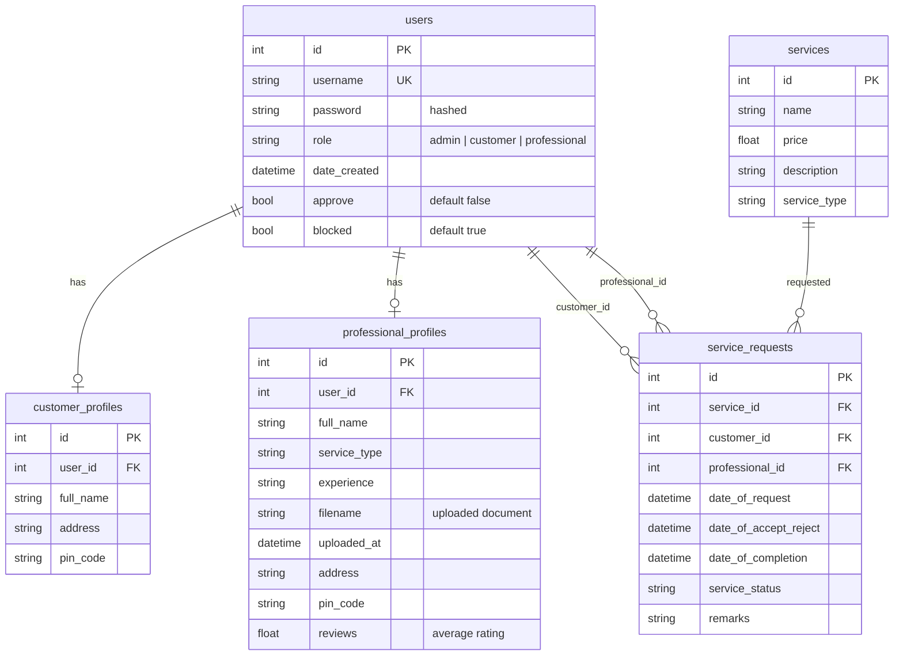

# Database

SQLite, file `backend/instance/db.sqlite`. Tables are created automatically by `db.create_all()`. There is no migration tool.

## ER diagram



## Service request status lifecycle

```
requested --accept--> accepted --customer closes--> completed
    '------reject---> rejected
```
A customer cannot create a new request for the same professional and service while one is `requested` or `accepted`.

## Notes
- Passwords are stored as PBKDF2-SHA256 hashes.
- `professional_profiles.reviews` is a running average, `(new_rating + old) / 2`, not a true mean of all ratings.
- A professional is matched to a request by comparing `professional_profiles.service_type` with the requested service id. Keep this in mind when adding services.
- SQLite does not enforce foreign keys unless `PRAGMA foreign_keys=ON` is set.
